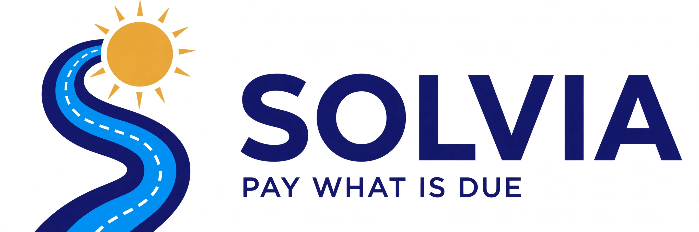

# Solvia

> **DRAFT — PayPal AI Hackathon project, in preparation. Not yet submitted.**

**Solvia** helps students and public visitors compare a parking plan, review vehicle details, pay the published permit fee with PayPal, and retrieve printable proof.

Current implementation: [US-developed AI, visit planning and staff review](docs/US-MODEL-AND-PLANNER.md).
The configured model is **OpenAI's US-developed GPT-OSS 120B, hosted through Together AI**.
Model origin does not establish a US-only processing region.
The header's AI indicator reports observed model responses and their timestamps.
See the [October 24 date-range repair and revised walkthrough](docs/review/DATE-RANGE-2026-10-24.md) for the latest verification scope.

Latest review: [changes and verification](docs/REVIEW-2026-10-19.md),
[hackathon readiness and judging](docs/HACKATHON-READINESS.md),
[design direction](docs/DESIGN-SYSTEM.md), and
[printable student and employee permits](docs/PRINTABLE-PERMITS.md).
Repeatable smoke/browser checks: [TypeScript + Playwright testing](docs/TESTING.md).
Review and regression workflow: [quality control](docs/QUALITY-CONTROL.md).
Baseline viability: [Stage One implementation evidence](docs/STAGE-ONE-EVIDENCE.md).
Impact, fair competitor comparison and proposed campus pilot:
[evidence and differentiation](docs/IMPACT-AND-DIFFERENTIATION.md).

## The name

Latin:

- **solvo** = "I pay, I settle what is due"
- **via** = "road" — the road a vehicle travels

Together: *pay what is due for the vehicle on the road.*

## Simple use case

Maria is a fictional adult student (18+). It is her first day.

1. Maria opens Solvia and picks how to start:
   - **Plan my parking:** describe weekdays and weeks, an exact start/end date range, or one dated visit. Choose **One visit** and confirm its date, or **Repeating visits** and confirm start/end dates, weeks and weekdays. The exact end date limits visits even when the last week is partial. Then compare catalog day/term costs. Continuing with day parking starts one pass for the first visit; a multi-visit estimate is not a prepaid bundle.
   - **Ask Solvia (the AI door):** choose a college, describe a car, and choose a permit. The configured reader drafts vehicle fields for review.
   - **The classic form:** pick campus, car, permit type, and start date — the same shape colleges already use.
2. Both doors build the **same application** through the same brain, and both show the **exact total first**, taken from a real fee table (see `data/fees.csv` — 10 campuses, every one publishing its student semester price, from the 2026-10-18 scan of 25 mycampuspermit.com pages; only the 10 with a published price ship, and no price is ever guessed).
3. Maria approves the total.
4. **PayPal Sandbox pays.** Test money only — no real money, no real student data.
5. Maria gets a receipt with the PayPal transaction ID and a downloadable demo permit PDF. This prototype does not grant real campus parking authorization.
6. Anyone can check the permit, no login, at its public link (`/verify?t=…`). The college sees a roster: who paid, who didn't.

Two more fictional people show the edges: **Elena** is a college employee — the demo policy exempts employees, so her permit is issued free at Apply. Actual campus employee fees and eligibility differ. **Pat** is a member of the public and pays the catalog fee in this demo; this does not reproduce every campus's affiliation rules.

Full flow: [docs/USE-CASE.md](docs/USE-CASE.md)

## Tools used

| Part | Tool |
|---|---|
| Payments (central) | PayPal Sandbox — Orders API (create order → student approves → capture), called directly over HTTPS from the app; a signature-verified PayPal webhook is the second road to the same truth. Paid lands only from a COMPLETED capture — never from a return page |
| AI adapter | **OpenAI's US-developed GPT-OSS 120B through Together AI** is the default hosted reader; **Phi-4-mini via Ollama** is optional. Vehicle and schedule drafts require review. Model identity, schema, grounded facts and deadlines are checked before labeling Together output. The catalog sets fees. See the current dated live-model evidence in [testing](docs/TESTING.md). |
| Fee comparison and staff review | **AG Grid Community edition** (free, sponsor) — the 10-college fee table and a demo-only saved-payment review, each with native HTML fallback. Operations counts concern saved Sandbox records, not settlement or real college revenue. |
| Printable permits | **PDFsharp 6.2.3 (MIT)** with embedded **Roboto (Apache-2.0)** — US Letter student and employee permits; no separate PDF application or OS font installation required |
| College search | Built-in deterministic search ships by default; an **Elastic** (sponsor) provider sits behind the same config seam — the live Elastic node was not run for this build and ELSER is not claimed — see [docs/SPONSORS.md](docs/SPONSORS.md) |
| Term calendar | Native calendar list (built-in) — term start, permit end, renewal date. Bryntum is **not** used: it has no free edition, and its 45-day trial would expire during judging — see [docs/SPONSORS.md](docs/SPONSORS.md) |
| Hosted copy | **Render** (sponsor) — **planned, not yet deployed.** There is no hosted URL yet; judges run it locally with the steps below |
| Supporting artifacts and plans | An [APIMatic context document](docs/apimatic-context.md), [Postman collection](postman/), [Zapier recipe](docs/zapier-recipe.md), and portable [fee-refresh script](tools/fee-refresh/) ship. Executing APIMatic, a live Zap, or KERNEL hosting is not verified. These artifacts are not additional completed sponsor integrations. |

**AG Grid Community is the demonstrated sponsor integration.** The Elastic adapter and other supporting artifacts remain separate from verified external-service use; see [sponsor status](docs/SPONSORS.md).

Our prize goal is a Grand Prize plus the AG Grid sponsor category where the
rules permit that combination. Actual Community grid use is demonstrated;
AG Grid Studio, AG Charts and executed APIMatic use are not claimed. Prize
eligibility and selection remain organizer decisions.

### AI model choice

**OpenAI's US-developed `openai/gpt-oss-120b` through Together AI is the default.** `AI_PROVIDER=together`
selects its hosted API; optional `AI_PROVIDER=ollama` uses Phi-4-mini at the
configured endpoint. Validated sources are `together`, `ollama`, or
`fallback`. The shared contract preserves explicit/ambiguous plate rules and
has no price field. People review the draft; the catalog supplies the fee.

Our server requests structured JSON with low reasoning effort, temperature 1,
and a 2,048-token total completion cap, following the
[Together GPT-OSS contract](https://docs.together.ai/docs/gpt-oss).
Only final content is parsed; reasoning is not displayed or logged. GPT-OSS
reasoning cannot be disabled entirely, and it consumes completion tokens.
Current [published prices](https://docs.together.ai/docs/serverless/models)
are $0.15 per million input tokens and $0.60 per million output tokens.
An illustrative 1,000-input/200-total-completion-token request costs **$0.00027** in
inference tokens; this is an estimate, not a measured bill or a fixed cost
per permit. Include instructions and schema in input-token estimates.

Together's key is privately configured in Development user-secrets. The same
earlier Qwen reader passed eight live vehicle cases twice on application
source `e3a4993`. Those are historical checks and timings, not evidence for
the replacement GPT-OSS model. Current results are recorded separately in
[testing](docs/TESTING.md). Historically,
a direct warmed CPU Phi-4-mini request returned in **32.26 seconds**, while
the app's **10-second** budget fell back. See
[provider-aware opt-in checks](docs/TESTING.md#opt-in-live-ai-checks).

## Privacy — why our AI is built this way

Use fictional adult (18+) people and vehicles for this demo. Browser answers
reach the app server and its selected model endpoint. Default Together mode
sends the sentence to a hosted service. Provider storage/training settings
and residency limits are described in [privacy](docs/PRIVACY.md); no account
privacy setting or zero-retention guarantee is claimed.

## Rules compliance — PayPal AI Hackathon

- [x] **Verify a real PayPal Sandbox capture** — the running app captured a $30.00 USD Fresno City College term permit and produced a paid receipt/PDF. An independent provider query confirmed `COMPLETED` and the exact amount. This used PayPal's official Sandbox test-card confirmation followed by Solvia's capture endpoint; wallet/Personal-buyer UI approval has not been verified.
- [x] Record **live application AI evidence** — 12 actual GPT-OSS 120B cases passed through Together: eight vehicle and four schedule cases, all observed sources `together`, with returned-model identity checked. This is separate from 132 controlled browser checks; the catalog sets the total.
- [x] **PayPal Sandbox only** — fictitious test accounts and test transactions, no real money, no real student data (Maria is fictional).
- [x] **Locally runnable prototype** — tested routes and services; complete the external-service checks in the readiness document before submission. Render hosting is planned.
- [x] **Public repository with an open-source license** — this repo is public, MIT License at the top level.
- [x] **Tools are listed and explained** — see the table above.
- [x] **New project chronology confirmed** — the participant confirmed Solvia was first built during this hackathon, after October 1, 2026. Solvia is an independent implementation and business model; its commits document development within the event.
- [ ] Demo video: under 3 minutes and public on YouTube. The replacement narrated/captioned MP4 is **160.0 seconds**, with fresh US-model footage. The public YouTube URL remains pending.
- [x] Submission text in English — this README and the saved/read-back Devpost story and instructions. Final submission remains open.
- [ ] Demo stays free for judges to test through the judging period (Dec 1–15, 2026).

Deadline: **Nov 12, 2026, 12:00 PM Pacific Time.**
Eligibility, registration, team details, and the actual Devpost submission remain participant checks. See the [official rules](https://paypalaihackathon.devpost.com/rules).

## Run it locally

The free/fallback preview requires the .NET 10 SDK. The complete PayPal-plus-AI
journey also needs Sandbox credentials and a working selected model endpoint
as described below. The free preview alone does not establish those integrations.
An earlier clean-copy run is recorded in [docs/CLEAN-INSTALL-LOG.md](docs/CLEAN-INSTALL-LOG.md).

### Step 1 — Install the .NET 10 SDK

Download the free .NET 10 SDK from
https://dotnet.microsoft.com/download/dotnet/10.0 and install it.
Then check it worked:

```
dotnet --version
```

You should see a version starting with `10.`

### Step 2 — Get the code

```
git clone https://github.com/jlhpacheco/solvia.git
cd solvia
```

Run every later command from this folder (the repo root) — the app
finds its fee table at `data/fees.csv` relative to it.

### Step 3 — (Optional) Add your free PayPal Sandbox keys

Without keys the app still runs: you can open every page, and the
free-college walk in Step 6 works end to end with no PayPal at all.
Keys are only needed to walk a *paid* college through the real
sandbox checkout. To get keys (free — test money only):

1. Go to https://developer.paypal.com and sign in. (Create a free
   developer account first if you don't have one.)
2. Open **Apps & Credentials**.
3. Select the **Sandbox** toggle.
4. Click **Create App**, give it any name (for example `solvia`),
   and create it.
5. PayPal shows a **Client ID** and a **Secret**. Copy both.

Then set them as environment variables in the same terminal where
you will run the app, or use Development-mode .NET user-secrets. The app
does not automatically load a `.env` file; never commit secrets
(`.env.example` at the repo root lists every variable name).

Windows (PowerShell):

```
$env:PAYPAL_CLIENT_ID = "paste your sandbox client id"
$env:PAYPAL_CLIENT_SECRET = "paste your sandbox secret"
```

Mac / Linux (bash):

```
export PAYPAL_CLIENT_ID="paste your sandbox client id"
export PAYPAL_CLIENT_SECRET="paste your sandbox secret"
```

For the approval click in the paid flow, PayPal also gives you free
sandbox test accounts: developer.paypal.com → **Sandbox →
Accounts**. The **Personal** account is the buyer; its email and
password are shown there. Test money only, never real money.

### Step 4 — Select an optional AI provider

#### Default hosted reader: Together AI + OpenAI GPT-OSS 120B

Create/sign in to a [Together account](https://api.together.ai/) and provision
a Together API key privately in the server's secret environment as
`TOGETHER_API_KEY`, or in Development .NET user-secrets as `Together:ApiKey`.
For Development setup, run the hidden-prompt helper from the repository root:

```powershell
.\scripts\Set-TogetherCredentials.ps1
```

It selects Together/model/timeout and sends the key through stdin to .NET
user-secrets, keeping it out of command arguments.
Never put a real key in chat, command arguments, logs, screenshots, browser
code or Git. Development user-secrets are per-user local configuration,
**not an encrypted vault**.

Set these non-secret settings in the terminal that runs Solvia:

```powershell
$env:AI_PROVIDER = 'together'
$env:TOGETHER_MODEL = 'openai/gpt-oss-120b'
$env:TOGETHER_TIMEOUT_SECONDS = '10'
```

Restart Solvia after changing server configuration. The default timeout is
10 seconds, with configured values clamped to 1–90. Missing credentials,
timeouts and unusable answers produce a labeled fallback. The adapter accepts
only the pinned `openai/gpt-oss-120b` model; an unsupported configured ID fails startup instead of silently using a different model.
Together is metered. The development key is configured privately and the
12 actual GPT-OSS application cases passed (eight vehicle, four schedule). Read
[privacy](docs/PRIVACY.md) before sending inputs and
the provider's [structured-output contract](https://docs.together.ai/docs/inference/chat/structured-outputs)
for the hosted request format.

#### Optional local reader: Ollama + Phi-4-mini

To run the model on your development computer:

1. Install Ollama from https://ollama.com.
2. Pull the model once (about 2.5 GB):
   ```
   ollama pull phi4-mini
   ```
3. Leave Ollama running at http://localhost:11434 and select
   `AI_PROVIDER=ollama` in Solvia's process before restarting.

The default Ollama endpoint is local to the app host, which may be a server.
Its request budget defaults to 10 seconds, including loading;
`OLLAMA_TIMEOUT_SECONDS` clamps to 1–90. A longer budget is a deliberate
local testing choice; measure the actual app response before recording a demo.

Either provider is optional for the free/fallback preview. A successful
provider-labeled application response is required for our live-model evidence.

### Step 5 — Build and run

```
dotnet build src/Solvia.slnx
dotnet run --project src/Solvia
```

The build should finish with 0 errors. On first run the app
creates its own small local database file (`solvia.db`, SQLite —
there is no database server to install).

Open the address the app prints — **http://localhost:5156**:

| Page | What it is |
|---|---|
| http://localhost:5156/ | Home — pick which fictional person you are (Maria is the default) |
| http://localhost:5156/Permits/Ask | The AI door: college / car description / permit choice |
| http://localhost:5156/Permits/Apply | The classic form door: campus, your car, permit type, start date |
| http://localhost:5156/Permits/My | My Permits — your applications, receipts, and permit PDFs |
| http://localhost:5156/Vehicles | Your vehicle garage — add / edit your cars |
| http://localhost:5156/College/Fees | The 10-college fee table (AG Grid Community) |
| http://localhost:5156/College/Dates | Term dates — term start, permit end, renewal date |
| http://localhost:5156/College/Roster | The college side: who paid, who hasn't |
| The check link on any receipt (`/verify?t=…`) | Anonymous public permit check — answers VALID or not |

### Step 6 — Try the free path (no keys, no Ollama needed)

1. On the home page, switch the person to **Priya**.
2. Open **Apply**. Priya has no car yet, so Solvia first shows an
   "Add a vehicle first" card — add any car (plate, state, make,
   model, color).
3. Back on **Apply**, pick **Modesto Junior College / Columbia
   College / YCCD** — permits there are FREE — permit type
   **Term permit**, any start date inside the term, and submit.
4. A $0 permit is issued on the spot: no checkout page, no PayPal.
   You land on **My Permits** with a permit number.
5. Open the permit's check link — it answers **VALID**, no login.

Try **Elena** the same way at any campus: she is an employee, so
her permit is issued free at Apply at every college, and her PDF
says **EXEMPT (Employee)**.

## Why PayPal

The Orders flow maps to a permit purchase: show the catalog total, let the
buyer approve it, capture through PayPal, then issue the receipt. The server
checks the capture status, amount, currency, and ID before marking it Paid.
AI drafts permit details; the person approves payment and the catalog sets
the price.

On October 19, the running app completed a **$30.00 USD Sandbox capture**
for a Fresno City College term permit. PayPal order `1G1852006N6969449`
and capture `7WR24202DB5257942` were independently confirmed `COMPLETED`;
Solvia issued receipt `SOL-2026-197973` and a paid PDF containing both IDs.
The verified path used PayPal's official Sandbox test-card confirmation and
Solvia's actual REST capture endpoint. Wallet/Personal-buyer UI approval is
a separate, unverified path. See [the testing record](docs/TESTING.md).
The follow-up Sandbox matrix passed **20 checks**: 16 permit purchases across
four colleges, student/public personas, and day/term permits, plus four
payment guards. It verified 14 completed captures totaling **$945.00 USD in
Sandbox test funds** and two free permits. All 16 PDFs passed content checks.
See [the provider results](docs/SANDBOX-RESULTS-2026-10-19.md).
Two further real-provider checks verified unapproved-order and refused-card
handling. Two actual remote-SDK/no-JavaScript checks created no orders.

<!-- SOLVIA-CURRENT-VERIFICATION:BEGIN -->
Application/test source [`5edf8a11e9ab87219c5a4587dc9f0efa3be4f80f`](https://github.com/jlhpacheco/solvia/tree/5edf8a11e9ab87219c5a4587dc9f0efa3be4f80f) passed **689/689 backend tests**, **168/168 desktop/phone TypeScript Playwright cases** and **32/32 tablet emulations**, each in a complete run. The controlled browser total is **200 distinct cases**; **50 smoke checks** are a subset of main. Emulation is not physical-device certification.

One actual Together date-only case first used a labeled fallback, then passed a same-source rerun with accepted GPT-OSS 120B output, October 27/One visit and hidden recurrence controls. It is one distinct case with two attempts, not a rerun of the historical live suite or continuous-availability proof. No new PayPal captures were added.

[Read the current repair and exact evidence](docs/review/ONE-VISIT-MODE-2026-10-23.md), [view the actual form](docs/review/Solvia-one-visit-form.png), or inspect [sanitized verification](docs/review/Solvia-one-visit-mode-verification.json). Older guides and results keep their dated scopes. Paid does not by itself mean currently valid; process-local AI limits are not billing caps or production authentication.
<!-- SOLVIA-CURRENT-VERIFICATION:END -->

A separate historical $30 term purchase has order `5CV7753505063622B`, capture
`9AP215253S500404B`. Provider lookup/retries confirmed one capture, followed by
PDF retrieval and anonymous-verification checks. It is excluded from the $945
matrix. The new **160-second** video uses freshly recorded GPT-OSS inference
and explicitly labels this reused term-payment segment as a different permit
from the planner's $1 first-day example. Public YouTube publication is pending.
For pending order IDs, buyer approval errors, or resuming payment, see
[Sandbox payment troubleshooting](docs/PAYPAL-TROUBLESHOOTING.md).

## Data note

`data/fees.csv` is research data scanned 2026-10-18 from the public pages of mycampuspermit.com (Parking Management Bureau), the incumbent permit store for these campuses. The shipped table holds exactly the 10 campuses that published a student semester price in that scan of 25 PMB pages; the other 15 published none and are not in the app. Every shipped row has a price (FREE is a price) — we never filled a price in.

CSV pricing is the accepted hackathon scope. No live college feed is connected.
Checkout snapshots the catalog fee; an open PayPal order or completed payment
cannot be repriced by a later catalog edit. Each purchase creates its own order,
so a separate hosted payment link for every college and price is unnecessary.

## License

MIT — see [LICENSE](LICENSE). Copyright (c) 2026 Jose Luis Pacheco.

Third-party components and their licenses: [NOTICES.md](NOTICES.md).


## Review the working flow

[Watch or download the 2:40 demo](docs/review/Solvia-demo.mp4), [read the screenshot guide](docs/review/Solvia-step-by-step-guide.pdf), or [inspect the quality-control process](docs/review/Solvia-quality-control.pdf).

The replacement recording shows actual OpenAI GPT-OSS 120B inference through Together, reviewed schedule/vehicle fields, deterministic planning and a saved-record Operations view. A clearly separate historical $30 term-purchase segment shows actual Sandbox capture and matching PDF references. Card approval uses the disclosed REST test harness; wallet login is not demonstrated. Narration is natural synthetic speech at unchanged tempo. All profiles are fictional. A public YouTube upload remains a submission gate.
