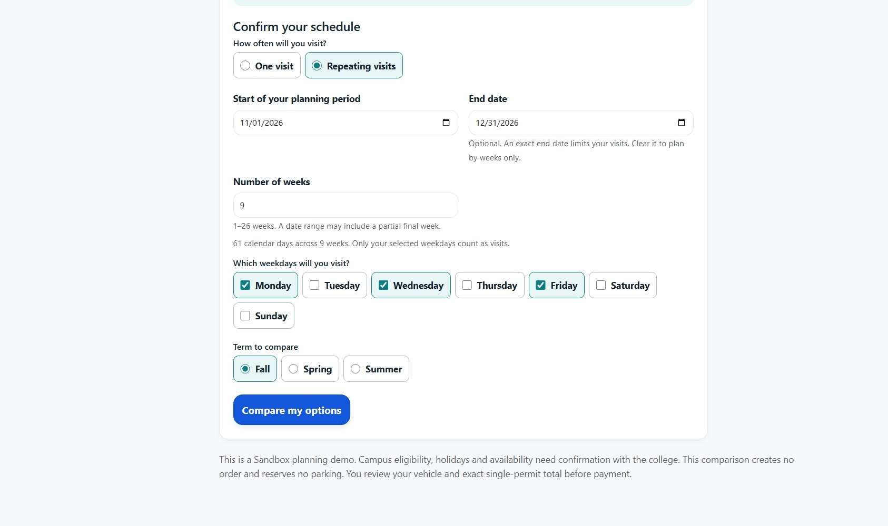

# Exact schedule ranges and revised walkthrough

Historical checkpoint, superseded by the [date-only confirmation and current guide](DATE-ONLY-2026-10-24.md). The linked source, earlier control layout and recorded test results below are preserved as historical evidence.

Application/test source: [`00da7d08857b04e8898dd85f84718774a4eeb099`](https://github.com/jlhpacheco/solvia/tree/00da7d08857b04e8898dd85f84718774a4eeb099).

The reported sentence was:

> I am coming to campus on monday, wednesday, and Friday from 11/01/2026 to 12/31/2026

Previously the reader rejected the two dates and left the weekday and duration controls empty. It now fills **November 1**, **December 31**, **9 calendar weeks**, and **Monday/Wednesday/Friday**. A real application request through Together AI returned an accepted `openai/gpt-oss-120b` result with those fields. This is one provider check, not a reliability or latency benchmark.



## What changed

- Repeating visits have editable start date, end date and weeks. Date edits derive inclusive calendar weeks; week edits update the end date. A partial final week is included in the week count without extending the exact date range.
- The server and deterministic grounding retain the exact end date. Provider output must agree with the grounded weekdays/week count; the model cannot set dates, fees, identity or payment state.
- The example spans 61 calendar days with 26 selected weekdays. A covering test authority verifies 26 visits, rather than 27 from rounding to nine full weeks.
- One visit still has only its visit date. Hidden repeating controls cannot block it. Without JavaScript, an explicit end date takes precedence; clear it to plan by weeks alone.
- Dates, modes and weekdays survive protected drafts, Change the plan and browser Back. WebKit could restore control properties before initialization, making an old result appear current. Comparison invalidation now uses HTML defaults as its baseline and checks restored state even without a saved custom draft.

College/date rules remain authoritative. **The demo Fall permit ends December 22**, so the reported December 31 range parses correctly but is rejected as outside that term's permit window. This repair does not invent additional coverage or sell a prepaid bundle of day passes.

## Verification and retained failures

See [machine-readable scope and hashes](Solvia-date-range-verification.json).

- **745/745 backend tests passed**, including 56 new reader/planner cases. Production C# was unchanged after that run; the later JavaScript restoration fix is covered by the final planner browser scope.
- **180 distinct desktop/phone cases are covered** through the 180-case main run and final **54-case planner rerun**. The main run initially passed 178 and failed two older assertions that unconditionally required Weeks. The revised assertions require server rejection when both duration alternatives are missing. The 54-case rerun covers all affected planner behavior. This is a distinct-case aggregate, not a clean 180-case final run.
- **24 distinct focused iPad emulation cases are covered** across six range scenarios in Chromium/WebKit portrait/landscape. The initial run passed 20 and failed four: one real stale-result assertion and three overall 60-second journey deadlines. Retained traces distinguish the stale-result defect from cumulative time-budget failures. Final targeted checks resolve those same identities. Only the two long multi-navigation journeys use a 90-second overall budget; individual assertions remain at 10 seconds. The older 32-case general tablet suite was not rerun.
- Smoke checks are a subset of the main cases, not additional cases to add to the total. Browser emulation is not certification on physical devices; automated reviews are not human usability research.

Initial and follow-up reports remain under `.playwright-data/date-range/`. Financial endpoints and provider traffic are blocked or disabled in controlled tests. No new PayPal order or capture was made for the real AI check or walkthrough; the historical capture matrix is unchanged.

## Revised step-by-step guide

The [16-page screenshot guide](Solvia-step-by-step-guide.pdf) contains 15 actual screens with separate numbered vector circles. All rendered pages were reviewed. The date controls were refreshed for this revision; unchanged journey screens come from the earlier October 24 capture.

The main example is a **new unpaid $1 Fresno Student day-pass application**. Separate existing **$30 Student/Public purchases** and an **Employee demo exemption** demonstrate PDF retrieval. They are explicitly different records. No payment for the new draft is implied.

1. Choose the fictional person: Maria (Student), Pat (Visitor/Public), or Elena (Employee).
2. Open Plan my parking; choose the college and describe or enter the schedule.
3. Confirm One visit, or repeating dates/weeks and weekdays; compare available options.
4. Choose day or term parking, review the vehicle and plate, then check the total.
5. For a positive total, use an eligible official PayPal Sandbox option and wait for confirmed capture.
6. Open the issued receipt and select **Download permit (PDF)**.
7. Retrieve it later through **My permits -> Permit (PDF)**. Pending drafts offer **Pay Now** and have no issued PDF.
8. Save or print US Letter at Actual size / 100%. Check the plate and validity dates. Employee exemption is a demo policy, not a campus entitlement.

## Reproduce

```powershell
dotnet test tests/Solvia.Tests/Solvia.Tests.csproj --no-restore
npm run typecheck
npx playwright test tests/e2e/planner.spec.ts tests/e2e/planner-visit-mode.spec.ts tests/e2e/planner-date-range.spec.ts
$env:SOLVIA_TABLET_WEBKIT='1'
npx playwright test --config playwright.planner-tablet.config.ts
```

Run browser suites sequentially on a resource-limited machine. The checkpoint's temporary tablet runner used the same scenarios, devices and offline environment on a separate port/database; the permanent configuration makes the focused matrix repeatable. Live-provider checks are separate from the default controlled suite.
