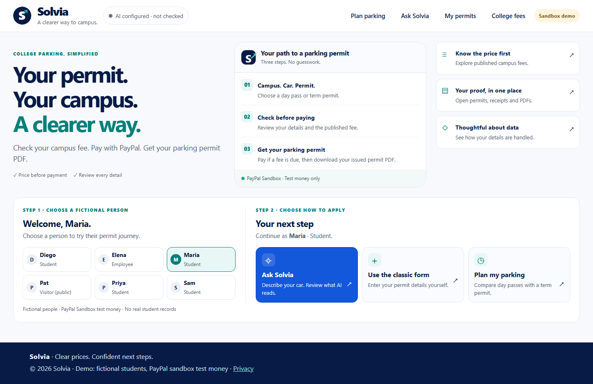
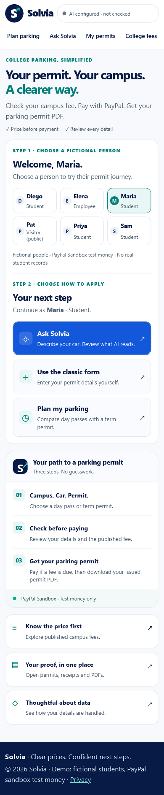

# A clearer home screen — October 24, 2026

The landing page now groups the fictional-person choices with **Your next
step**, instead of separating them into two full-width panels. Ask Solvia,
the classic form and the parking planner are three labeled action cards.
Published fees, permit/receipt/PDF access and privacy are compact links
alongside the overview on wide screens.

On phones, the person choices and application actions come before the
explanatory journey and resource links. Names, resolved roles and the
selected person remain visible. All person/action targets are at least
44 CSS pixels in each dimension. Native forms and links retain keyboard
and no-JavaScript operation. The AI-status disclosure remains available;
checking it never calls a model. Homepage styling is scoped to this page.

The short-laptop layout fits all three action cards within a 1280×720
viewport. On the narrowest tested iPhone width, the role spans the tile
width so “Employee” is not split into fragments. The journey explicitly
says to pay **if a fee is due**, preserving free and Employee-exempt paths.

## Measured use of space

Read-only Chromium observations used the same default fictional person,
normal text size and scroll position zero. Values are CSS pixels.

| Viewport | Old page height | Revised page height | Old first-action top | Revised first-action top |
|---|---:|---:|---:|---:|
| Desktop, 1440×900 | 1498 | 934 | 944 | 601 |
| Phone width, 390×844 | 3022 | 1885 | 1843 | 762 |

The page is approximately 38% shorter in these two controlled comparisons.
This measures layout, not human completion time, physical-device performance
or a usability study. Safari-engine coverage is verified separately through
Playwright WebKit emulation.

## Review and verification

See [Testing Solvia](../TESTING.md) for the exact final run scope and report
locations. A second agent reviewed the source without changing it. Its
footer-layout and free-permit wording findings were corrected before the
final browser run. Visual inspection also corrected headline wrapping,
narrow employee labels and short-laptop spacing. Earlier startup/interrupted
attempts are not counted as additional passing cases.

These changes retain the existing routes, persona selection, AI provider,
payment handling and stored permits. Controlled checks use an isolated
database and disabled provider credentials. No real-model request or
PayPal order/capture was needed for this layout update. Browser emulation
does not certify physical iPhone or iPad hardware.

## Current screenshots

The captures show the default fictional profile in the controlled test
environment. A configured-but-unchecked AI badge is not live-model proof.

