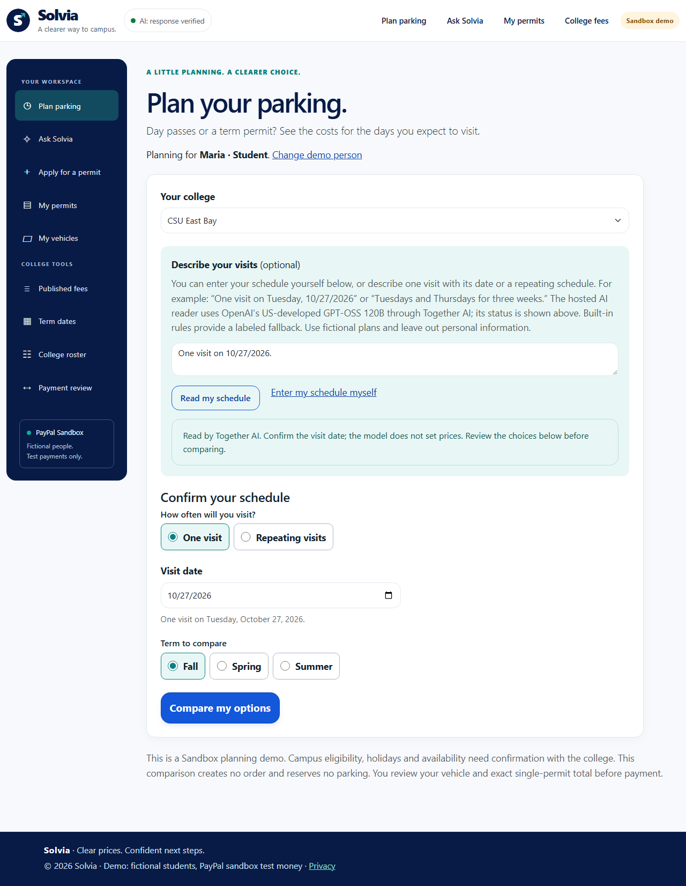

# One visit means one date — October 23, 2026

The earlier form represented a single day with a one-week window and a weekday.
That calculation produced one visit, but the questions were confusing. The
planner now separates the person's intent from the internal counting method.

| Visit type | Questions shown |
|---|---|
| One visit | Visit date. No number of weeks or weekday selections. |
| Repeating visits | Planning start date, number of weeks and visiting weekdays. |

The AI reader selects One visit for an unambiguous dated one-off. A sentence
such as **“One visit on 10/27/2026”** needs no named weekday: the strict calendar
parser derives Tuesday from that exact date. Explicit conflicting weekdays,
invalid dates and uncertain descriptions still require review. People can
choose the visit type and enter their schedule without AI.

The server derives exactly one visit from the date in SingleVisit mode,
regardless of posted recurrence fields. It preserves date errors, ignores
irrelevant recurrence validation, and includes the mode in comparison freshness
checks. Protected drafts and browser history retain the mode and date through
Back, handoff and revision. Existing protected one-day drafts migrate only when
their one-week/one-weekday facts already match the date; an explicit new choice
of repeating visits is preserved. No database migration is required.

Native radio controls update the fields immediately with JavaScript. Without
JavaScript, **Use this visit type** posts to an owner-checked, CSRF-protected
route without inference or payment. Switching to repeating visits requires
confirmation of recurrence answers. The live date preview is JavaScript-only,
so a no-JavaScript date edit cannot leave a stale displayed date beside the input.

## Verified scope

Application/test source: [`5edf8a11e9ab87219c5a4587dc9f0efa3be4f80f`](https://github.com/jlhpacheco/solvia/tree/5edf8a11e9ab87219c5a4587dc9f0efa3be4f80f).

- **689/689 backend tests passed**, zero failed/skipped.
- **168/168 desktop/phone TypeScript Playwright cases passed** in one complete run; **50 smoke checks** are a subset.
- **32/32 tablet cases passed** in one complete Chromium/WebKit portrait/landscape emulation run.
- Build, TypeScript and JavaScript syntax checks passed; the build had zero warnings/errors.
- Three agents assisted implementation, test authoring and independent review. This is automated software review, not a human usability study or physical-device certification.

The controlled browser total is **200 distinct cases**, from the two complete
runs. These checks add no PayPal capture.

One distinct real Together date-only case ran twice. The first attempt used the
labeled fallback and failed the strict hosted-source assertion. A bounded direct
API diagnostic also returned HTTPError without a recorded status; it did not
establish the application's fallback cause. The same-source application rerun
accepted validated `openai/gpt-oss-120b` output and passed in **4.506 seconds**,
showing October 27, One visit, hidden recurrence controls and verified AI status.
No production code or prompt changed between the live attempts. Both reports
remain retained; this is not a claim of uninterrupted provider availability or
a rerun of the complete 13-case opt-in catalog. Timing includes browser/app work.

[Sanitized verification and evidence hashes](Solvia-one-visit-mode-verification.json)
retain the source and exact scopes. Earlier guides, screenshots and test records
keep their original dated versions.

