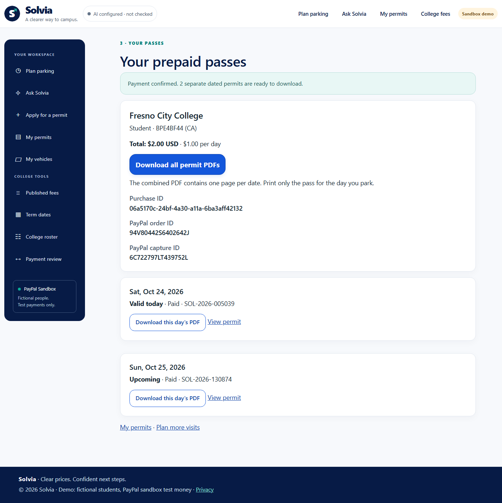

# Prepaid dated day passes

This update adds an explicit purchase for several selected visit dates. It uses the same published fee catalog, category resolver, official PayPal checkout, issuance authority and permit validation as a single day pass.

## Person's journey

1. In **Plan parking**, describe a schedule or enter start/end dates and weekdays. Confirm the reader's draft. AI reads the schedule; ordinary server rules compute prices and comparisons.
2. Compare day-pass costs with a term permit covering the schedule. No order or charge occurs during comparison.
3. For several visits, choose **Buy these dates**. Choose a saved vehicle (or add one), and uncheck any dates that are not needed.
4. Choose **Review these dates**. Read the exact dates, vehicle, unit price and full USD total. The term alternative is shown when available. An unpaid selection can be released and revised before payment starts.
5. Choose an official PayPal payment option. One order holds the selected dates and total; a retry resumes that order. There are no scheduled per-visit charges from Solvia.
6. Only a verified `COMPLETED` capture with the exact total, USD currency and an unused capture reference settles the purchase and its dated permits together.
7. Open **Your prepaid passes** or **My permits**. Download individual permit PDFs, or one combined PDF with a page per date. Future permits are paid and upcoming; public verification becomes valid only on the printed day.

A single visit keeps the existing one-day application flow. Students and public demo profiles pay the published daily price. The existing employee exemption issues free permits without a PayPal order. A free term price does not make a published positive daily price free.

## Money and integrity controls

- Parent `PrepaidPurchase` owns one financial order/capture and the total. Child `PermitApplication` rows retain their own day, fee, receipt number and verification token. Shared references are derived for display, never copied into each child's stored payment fields.
- Dates come from a short-lived data-protected schedule tied to the current demo profile. Posted dates must be a distinct subset. Vehicle ownership, category, prices, totals and duplicate coverage are checked on the server.
- An unchanged submission reuses the draft purchase. Existing day applications and paid/free term coverage block overlapping dates rather than silently charging again.
- A reviewed fingerprint covers the owner, vehicle facts, campus, category, term, unit fee, total and each dated child. Changed facts or a changed catalog quote require another review before starting a new order.
- Dates, vehicle and total are locked once an order exists. Child routes cannot separately reprice, revise or pay part of the purchase. A pending draft can be released only before any order, capture or issuance exists.
- A capture settles all children atomically. Receipt-number generation reserves numbers already staged on sibling permits before the shared save, as well as checking the saved database. Unapproved, pending, refused, mismatched or reused financial references do not issue paid permits. Provider retries and signed webhook recovery share the same settlement rules.
- PDFs are gated on issued payment/exemption state. A prepaid receipt uses Pacific calendar dates and the common permit-validity authority to distinguish Valid today, Upcoming and Expired.
- Operations adds each child's allocated daily fee once. It does not add the whole shared purchase total for every child, and an upcoming paid permit alone is not classified as a payment problem.

## Verification sources

- `PrepaidPurchaseTests`: real SQLite and issuance with counting provider stubs; date/price/identity tampering, concurrency, capture verification, rollback, retries, past dates, exemptions and safe unpaid revision.
- `PrepaidFlowIntegrationTests`: real MVC/DI/Razor/antiforgery, protected selection subsets, ownership, child-route protection and pending PDF gates.
- `PermitNumberBatchTests`: deterministic staged/saved receipt collisions and ten-draw exhaustion, including two real issuances committed once.
- `PrepaidReadTests`: paid/future views, financial references, Operations totals and PDF packet content; saved fixtures are explicitly separate from provider transactions.
- `WebhookTests` prepaid cases: signed-event paths with a stub verifier, shared settlement, event retries, amount/order/capture conflicts and save rollback.
- `tests/e2e/prepaid.spec.ts`: real isolated app journeys and separately labeled SDK transport simulations; no provider payment is inferred from a mocked callback.
- `tests/sandbox/prepaid-matrix.spec.ts`: opt-in actual Sandbox card confirmation, Solvia REST capture, independent provider lookup, retry references and PDF downloads. It does not exercise human PayPal wallet sign-in.

### Verified provider and database results

Two actual Sandbox purchases completed: a student at Fresno City College paid $2 for two $1 dates, and a public visitor at CSU Monterey Bay paid $10 for two $5 dates. Both order-create retries returned the original order; capture retries returned the original capture. Independent PayPal order lookups found exactly one completed USD capture per purchase. These are $12 in test funds, not real-money charges. Official Sandbox card confirmation and Solvia REST capture were exercised; wallet popup approval was not.

The initial provider attempt stopped before approval because an exact-object assertion rejected PayPal's extra empty `breakdown` field. The assertion now checks the exact monetary value and currency while allowing other response fields. The successful rerun resumed the same two saved orders and created no replacement orders. Initial evidence is retained privately.

All four individual PDFs and both two-page packets passed extraction checks for the shared order, capture and purchase references. Public verification was checked independently without the buyer profile: both today's permits were valid, and both tomorrow's permits were not yet valid. Phone-sized receipt readbacks had no horizontal overflow. This is viewport emulation, not physical-device certification.

The consistent SQLite backup is retained privately under `.playwright-data/backups/prepaid-upgrade-20261024T231806Z/`. The additive upgrade preserved all 32 existing permit rows byte-for-byte by canonical row hashes; `PRAGMA integrity_check` returned `ok`.

Three agent workstreams reviewed the financial core, read/PDF/webhook surfaces and SDK/TypeScript boundaries. Cross-review found the missing Razor Styles section and a date-only receipt status calculation; both were corrected before deployment. This is assisted engineering review, not external certification.

[Phone receipt layout](Solvia-prepaid-receipt-phone.png)

### Final execution checkpoint

- **854/854 backend tests passed** in the final complete run. The four additional number-generation checks deterministically cover an unsaved sibling collision, an Added reservation, a saved/untracked collision and ten-draw exhaustion. The final application build includes this fix.
- The broad **210-case desktop/mobile TypeScript Playwright run** passed 205 and failed five obsolete wording/label/strict-alert assertions. The final targeted rerun passed **6/6**, including every original failure and one overlapping no-JavaScript check. All 210 case identities are covered across these runs; **64 smoke cases are a subset**. This is not one clean final 210-case run.
- The final complete **12/12 iPhone/iPad WebKit emulation run passed**, covering student/public selections, duplicate submission, ownership, no-JavaScript rejection and explicitly simulated SDK transport callbacks. The initial WebKit attempt was stopped after the known old alert selector and cumulative 90-second budgets failed; its artifacts are retained separately. Only the overall WebKit journey budget became 180 seconds. Ten-second assertion deadlines and every money, ownership, date and PDF check remain unchanged. These controlled runs are not physical-device performance benchmarks.
- TypeScript `tsc --noEmit`, JavaScript syntax and diff whitespace checks passed. The new feature made no actual AI request and does not change the configured Together/OpenAI GPT-OSS model.
- Final localhost readbacks rechecked both paid purchases, four public dated-validity outcomes, phone overflow and download links without another financial mutation. All 32 earlier permit rows remain unchanged; the four newly paid dated permits bring the local total to 36. SQLite integrity is `ok`, with no foreign-key violations.

The first backend invocation aborted at the test-host connection and provided no results. The first executed full run passed 838/848, exposing five direct-controller null-helper cases and five outdated copy/encoded-label assertions. Fixes were followed by a clean 848 run, then 850 with added revision checks, and the final 854 after deterministic batch-number tests. Initial browser traces and the provider response-shape failure are retained privately, not erased or counted as passes. Historical test and capture counts in earlier review documents describe their own runs; they are not new evidence for this feature.

The [sanitized verification record](Solvia-prepaid-verification.json) includes the normalized source hash, exact run scopes and provider/device limitations.

## Deployment and scope

The local SQLite upgrade is additive: two new tables and indexes, with no changes to existing permit rows or columns. Back up a populated database with SQLite's backup API before rollout. Ignored local databases and Sandbox reports contain fictional test data and are not committed.

This is a Sandbox hackathon demonstration using a researched catalog snapshot and demo permit-date rules, not a production agreement with a college. Pay Later eligibility is decided by PayPal; prepaid dated permits work without borrowing or deferred per-visit billing. Campus policy, refunds, production authentication and live price synchronization remain separate deployment work.
