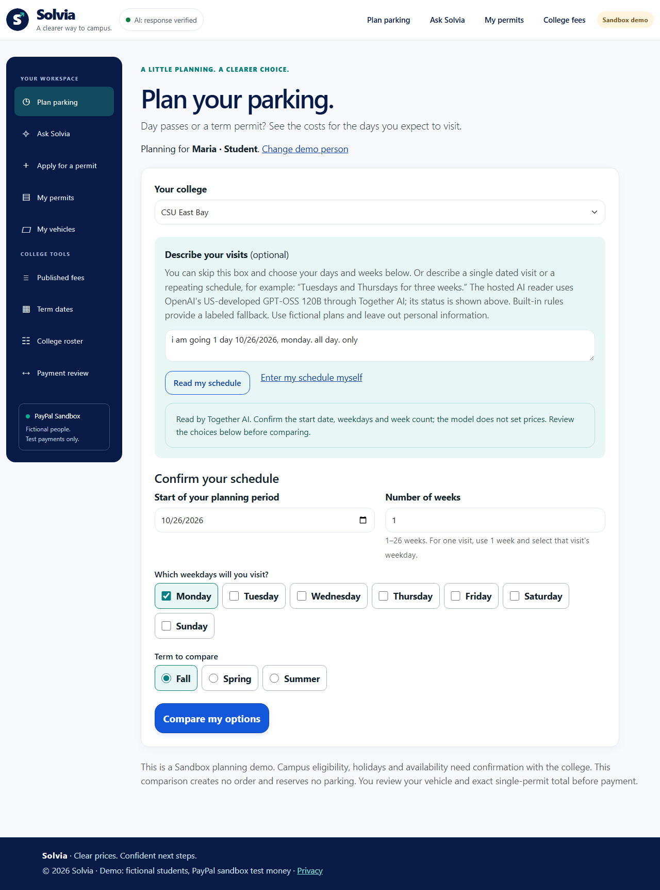

# Single dated visits and observed AI status — October 23, 2026

## Reported issue and correction

The sentence **“i am going 1 day 10/26/2026, monday. all day. only”** previously
selected Monday but left weeks empty and retained the old planning date.
The reader now supplies **October 26, Monday, one week**. The confirmed plan
therefore contains **one visit**, and its first-day continuation retains that date.
The person still reviews the draft before comparison or purchase.

The hosted schema remains weekdays/weeks only. A separate invariant parser
grounds an optional full US or ISO date in the original sentence. It cannot
take a date from model output. A single dated visit with a matching named
weekday means one week; a recurring one-day-per-week plan for three weeks
remains three weeks. Date ranges, malformed/partial dates, weekday conflicts
and contradictory one-time details require review. Missing duration remains
missing. A recurring start date is a planning anchor, not necessarily a visit.

The controller replaces the old attempted date only when a grounded date is
present. Protected owner-bound drafts retain that date and sentence through
GET redirects and revision. Comparison still uses confirmed facts and integer
catalog cents. Neither reading nor comparison creates a payment order.

## Evidence-based AI indicator

The header's native disclosure shows **Together AI · openai/gpt-oss-120b** and
observed timestamps. Model origin is US development; this is not a US-only
processing-region claim. Configuration alone does not earn a successful label.

| State | Meaning |
|---|---|
| Not configured / not checked | No accepted response has been observed on this app instance. |
| Reading | A real draft read is pending; success is not yet claimed. |
| Response verified | A selected adapter returned a validated model result within ten minutes. |
| Earlier response | The last successful response is older; current availability is unconfirmed. |
| Latest read used rules / interrupted | The last completed attempt did not establish a new model success; historical success time remains visible. |
| Status unavailable | The browser could not refresh observations; this is not a model-outage claim. |

Two bounded process-local lanes observe vehicle and schedule results. They
retain no user text, draft fields, secrets, transport bodies or user identifiers.
`GET /api/ai/status` is read-only, uncached and invokes neither a model nor the
database. Visible pages refresh observations gently; no paid health probes run.
Native server-rendered disclosure works without JavaScript. Restarting clears
history. The app's existing strict adapter validation still controls source labels.

## Review findings retained

Three agents assisted parser implementation, status implementation and independent
read-only review. These are software reviews, not human usability participants or
external certification. The coordinator reproduced and resolved the findings.

- Strict date candidates now include entire malformed numeric chains and
  leading/trailing separators, preventing accidental reuse of the old date.
- Two new HTTP tests initially stopped at an expected canonical Questions GET
  redirect. Their helper now follows that redirect before asserting retained facts.
- The first browser run exposed a real pending-label bug: a button's reflected
  `formAction` can be the current page even without an override attribute. The
  handler now checks the attribute before choosing the enclosing form action.
  The held-navigation test also needed protocol-side observation rather than a
  locator assertion waiting for that deliberately held navigation. Separate
  vehicle/form-action and planner/button-override cases cover both paths.
- A real expanded-panel visual check caught left-edge clipping on a tablet.
  The disclosure now anchors from its left side on larger screens and stays in
  normal flow on phones. Desktop/phone/tablet expanded-panel checks passed.
- A fast back/forward restore could clear the refresh timer within the request
  throttle; the throttled path now schedules the next read-only refresh.

## Verification

Application/test source: [`83748c8dc305a5e1f9df98df3ea4faf2f846afa9`](https://github.com/jlhpacheco/solvia/tree/83748c8dc305a5e1f9df98df3ea4faf2f846afa9). Full backend: **661/661 passed**. Current controlled browser coverage: **156 distinct desktop/phone cases**, including **48 smoke checks**, plus **28/28 tablet emulations**. The main result is an aggregate: initial 152/154, then final 12/12 status cases, with 8 overlapping passed identities and 4 explicit pending-path identities replacing the 2 old failing titles. Final status JS/CSS delta was verified by the 12 status cases and 28 tablet cases; broad C#/Razor source is unchanged. This is not one clean 184-case full run.

One distinct actual Together case passed twice; the final execution took **1.929 seconds** and verified source `together`, pinned model, October 26/Monday/one week, and status `recent`. It made no payment. This is a separate case, not a rerun of the historical 12-case live suite, and elapsed browser/application time is not provider-only latency or a guarantee.

[Sanitized proof](Solvia-single-visit-AI-status-verification.json) retains source, scopes and report hashes. [Full testing record](../TESTING.md) preserves initial failures and corrections. Historical media/PDFs keep their original versions. This repair adds no PayPal capture or human-study claim.

